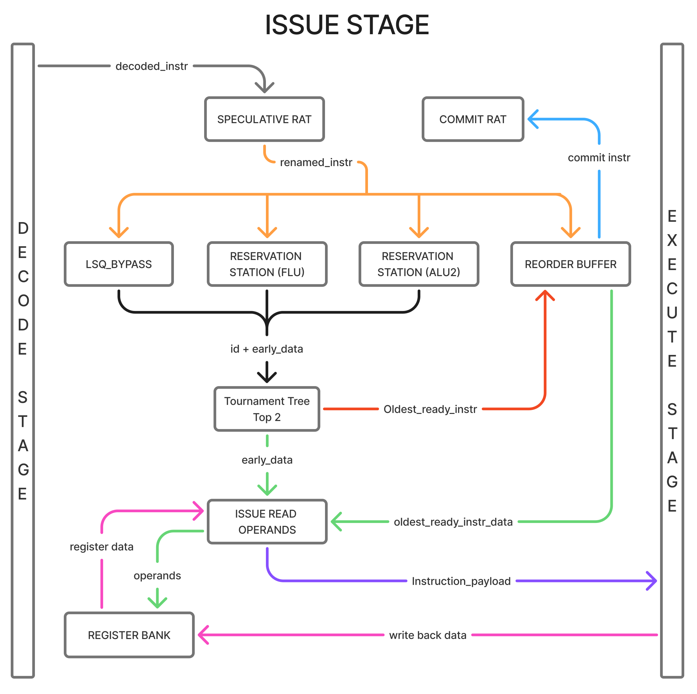
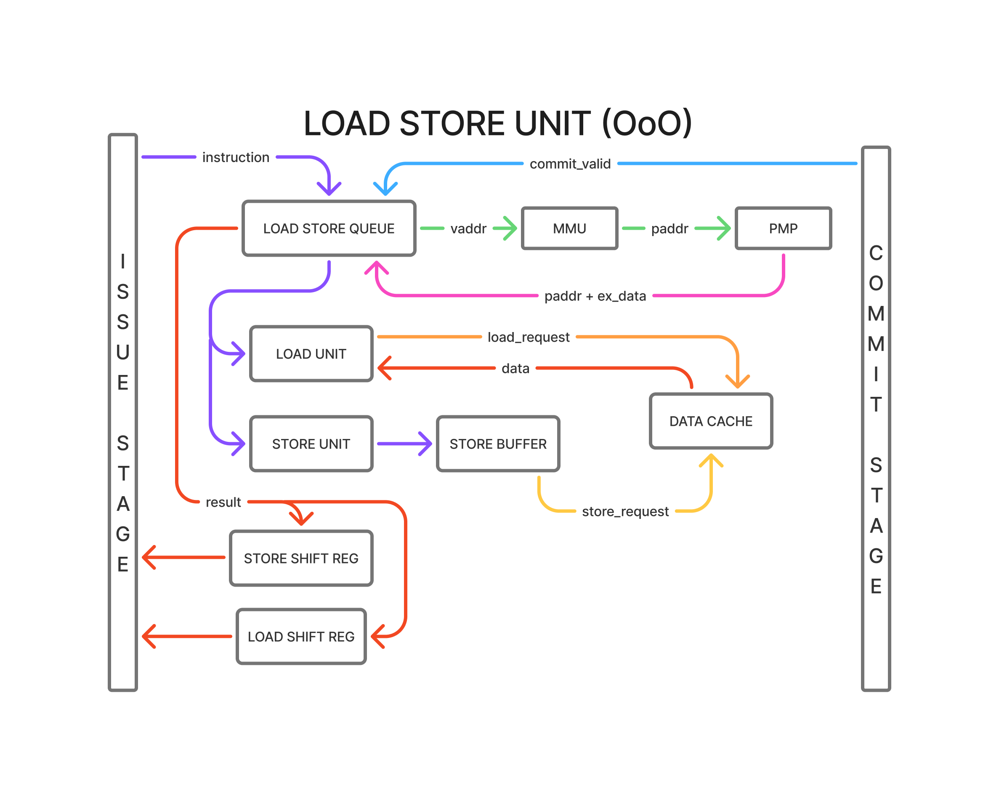

# CVA6 Out-of-Order

This repository is a fork of the original [CVA6](https://github.com/openhwgroup/cva6), used in
bare-metal 32-bit mode. It contains a modified version of the core turned into an out-of-order
core that works both in superscalar (dual-issue) and in single-issue configuration. It passes the
`riscv-tests` ISA suites rv32ui, rv32um and rv32uc (including `fence.i`) in both configurations.

This work was carried out by Telmo Fieux as the final project of a Master's degree at Université
Toulouse III – Paul Sabatier. The new code is released under the same licence as the original
CVA6 repository (Solderpad Hardware License).


## Results

Summary of the results on a Digilent Zybo Z7-20 (Zynq-7020) for the main configurations, taking
into account LUT usage and maximum clock frequency. Several configurations were explored, but the
dual-issue ROB16 version is the best-performing one and the main focus of this work: most
comparisons refer to it. IPC and speed-ups are measured on the board; speed-ups are relative to
the original CVA6 (geometric mean over FFT, MNIST and CoreMark).

| Configuration                                | Core LUTs | F<sub>max</sub> (MHz) |   FFT IPC | MNIST IPC | CoreMark IPC | CoreMark/MHz | Speed-up (cycles) | Speed-up (time at F<sub>max</sub>) |
| -------------------------------------------- | --------: | --------------------: | --------: | --------: | -----------: | -----------: | ----------------: | ---------------------------------: |
| Original CVA6 (in-order, single issue, SB16) |    14 381 |                  49.7 |     0.770 |     0.654 |        0.699 |         2.55 |             1.00× |                              1.00× |
| In-order, dual issue, SB8                    |    18 410 |                  53.2 |     0.949 |     0.873 |        0.865 |         3.15 |             1.27× |                              1.36× |
| In-order, dual issue, SB16                   |    23 269 |                  42.5 |     0.948 |     0.874 |        0.866 |         3.15 |             1.27× |                              1.08× |
| **Out-of-order, single issue, ROB16**        |    21 838 |                  44.6 |     0.837 |     0.891 |        0.779 |         2.84 |             1.18× |                              1.06× |
| **Out-of-order, dual issue, ROB16**          |    33 794 |                  42.2 | **1.101** | **1.415** |    **1.064** |     **3.87** |         **1.68×** |                          **1.42×** |

SB: scoreboard entries (in-order); ROB: reorder buffer entries (out-of-order). F<sub>max</sub> comes
from an out-of-context place and route of the core.

In short, compared with the dual-issue in-order core:

- at equal frequency, the dual-issue OoO core is 32 % faster on average (geometric mean of the
  three benchmarks);
- with each core at its own F<sub>max</sub>, it is only 5 % faster than the fastest in-order
  configuration (SB8), because the out-of-order logic lowers the maximum frequency on FPGA;
- on a memory-bound micro-benchmark with independent cache misses (`membench`), it is 62 %
  faster at equal frequency and 28 % faster at F<sub>max</sub>, because it overlaps several
  cache misses. When each miss depends on the previous one (pointer chasing), there is no gain.


### Paper and raw data

The [`Artefacts`](./Artefacts/) folder contains:

- [`CVA6_Out_of_Order_Paper.pdf`](./Artefacts/CVA6_Out_of_Order_Paper.pdf) : the **paper** describing the architecture in detail, the measurement method and an extensive
  analysis of the bottlenecks and limits of this design;
- [`fpga_results.md`](./Artefacts/Results/fpga_results.md): all synthesis results and on-board runs;
- [`simulation_results.md`](./Artefacts/Results/simulation_results.md): all simulation counters.

### Reproducing the results

The build, simulation and synthesis flows are unchanged: follow the original CVA6 README below.
One benchmark was added to measure the impact of cache misses: `membench`
(`sw/app/membench`).

## The Issue Stage

Most of the modifications are in the issue stage and in the execute stage (more precisely, the
load/store unit). The issue stage has a new instruction flow, with a register allocation table,
several reservation stations and other new modules. The new instruction flow is summarised in
the following diagram:



## Load/Store Unit

The LSU now has a load/store queue, which takes over part of the work of the former load and
store units and checks the dependencies between memory operations. A simplified view of the new
instruction flow is shown below:



## Known Issues

Some features have not been tested and probably no longer work:

- atomic operations (A extension) are not supported: they are disabled in the configuration and
  trap as illegal instructions;
- the MMU configuration has not been tested;
- the FPU, CV-X-IF and accelerator interfaces are not supported.

These features would probably require only small modifications to work again.

# Original Repository README

# Original repository README

# Getting started

To get more familiar with CVA6 architecture, a partial documentation is available:

https://cva6.readthedocs.io/en/latest/

Checkout the repository and initialize all submodules:
```
git clone https://github.com/ThalesGroup/cva6-softcore-contest.git
git submodule update --init --recursive
```

Do not forget to check all the details of the contest in [Annonce RISC-V contest 2025-2026.pdf](./Annonce_RISC-V_contest_2025-2026_v1.3.pdf).

This repository contains the files needed for the 2025-2026 contest focusing on fast fourier transform computation. The goal is to modify the CV32A6 architecture and/or add a coprocessor to accelerate the FFT algorithm provided as an
application written in C.

# Prerequisites


## Questa tool
Questa Prime **version 10.7** must be used to measure power during the simulations.
Other simulation tools and versions will receive no support from the organization team.

## Vitis/Vivado setting up
For the contest, the CVA6 processor will be implemented on Zybo Z7-20 board from Digilent. This board integrates a Zynq 7000 FPGA from Xilinx.
To do so, **Vitis 2024.1** environment from Xilinx needs to be installed.

Furthermore, Digilent provides board files for each development board.

These files ease the creation of new projects with automated configuration of several complicated components such as Zynq Processing System and memory interfaces.

All guidelines to install **vitis 2024.1** and **Zybo Z7-20** board files are explained in
https://reference.digilentinc.com/reference/programmable-logic/guides/installation.

**Be careful about your linux distribution and the supported version of Vitis 2024.1 environment.**


## Hardware
If you have not yet done so, start provisioning the following:

| Reference	                 | URL                                                                             |	List price |	Remark                            |
| :------------------------- | :------------------------------------------------------------------------------ | ---------: | :-------------------------------- |
| Zybo Z7-20	                | https://store.digilentinc.com/zybo-z7-zynq-7000-arm-fpga-soc-development-board/ |    $299.00	| Zybo Z7-10 is too small for CVA6. |
| Pmod USBUART               |	https://store.digilentinc.com/pmod-usbuart-usb-to-uart-interface/               |      $9.99 |	Used for the console output       |
| JTAG-HS2 Programming Cable |	https://store.digilentinc.com/jtag-hs2-programming-cable/                       |     $59.00	|                                   |
| Connectors                 |	https://store.digilentinc.com/pmod-cable-kit-2x6-pin-and-2x6-pin-to-dual-6-pin-pmod-splitter-cable/ | $5.99 |	At least a 6-pin connector Pmod is necessary; other references may offer it. |


# FPGA platform

A FPGA platform running **CV32A6** (CVA6 in 32 bits flavor) has been implemented on **Zybo Z7-20**

This platform includes a CV32A6 processor, a JTAG interface to run and debug software applications and a UART interface to display strings on hyperterminal.

The JTAG-HS2 programming cable is initially a cable that allows programming of Xilinx FPGAs (bitstream loading) from a host PC.

In our case, we use this cable to program software applications on the CV32A6 instantiated in the FPGA through a PMOD connector.

## Get the Zybo ready

1. First, make sure the Digilent **JTAG-HS2 debug adapter** is properly connected to the **PMOD JE** connector and that the USBAUART adapter is properly connected to the **PMOD JB** connector of the Zybo Z7-20 board.


2. Generate the bitstream of the FPGA platform:
```
make cva6_fpga
```

3. When the bitstream is generated, switch on Zybo board and run:
```
make program_cva6_fpga
```
When the bitstream is loaded, the green LED `done` lights up.


4. Get a hyperterminal configured on /dev/ttyUSBx 115200-8-N-1 LF mode

Now, the hardware is ready and the hyperterminal is connected to the UART output of the FPGA. We can now start the software.


**NOTE: The reset is mapped on the Y16 button near the PMOD, not on the RESET button.**

## Get started with software environment

This section describes how to build the software environment for the contest. To build any other application available in the **sw/app** folder, replace **mnist** with the name of the application folder : **fft**, **helloworld**, **coremark**...

**mnist** & **coremark** are usied to make sure nothing is broken. But they are not the app we are interested in speeding up.

**The "fft" app is the only one we are interested in for the contest.**

### Building the docker image

Install Docker on the workstation.

A **sw-docker** docker container is used to ease the installation of RISC-V tools including the toolchain and OpenOCD.

1. The **sw-docker** image can be built using the following command:

```
docker build -f Dockerfile --build-arg UID=$(id -u) --build-arg GID=$(id -g) -t sw-docker:v1 .
```

### Using the docker image

the **sw-docker** Docker container consists of the entire RISC-V compilation chain as well as the openocd tool.

2. To compile software applications in **sw/app**, you need to use Docker container with the following command:

```
docker run -ti --privileged -v `realpath sw`:/workdir sw-docker:v1
```

The **sw** directory is mounted in the docker container.


Once in the **sw-docker** Docker container, you are in the default directory **/workdir** which corresponds to the sw directory in the host OS.

```
user@[CONTAINER ID]:/workdir$ ll
total 24
drwxrwxr-x  5 user user 4096 Nov 23 10:57 ./
drwxr-xr-x  1 root root 4096 Nov 24 09:09 ../
-rw-rw-r--  1 user user 2620 Nov 23 10:57 README.md
drwxrwxr-x 18 user user 4096 Nov 23 10:59 app/
drwxrwxr-x  5 user user 4096 Nov 23 10:57 bsp/
drwxrwxr-x  2 user user 4096 Nov 23 10:57 utils/
```

3. To compile fft application, run the following commands.
```
user@[CONTAINER ID]:/workdir$ cd app
user@[CONTAINER ID]:/workdir/app$ make fft

```
At the end of the compilation the fft.riscv executable file must be created.

4. Then, in the Docker container, launch **OpenOCD** in background:
```
user@[CONTAINER ID]:/workdir/app$ openocd -f openocd_digilent_hs2.cfg &
[1] 90
user@[CONTAINER ID]:/workdir/app$ Open On-Chip Debugger 0.12.0-g9ea7f3d (2025-09-02-12:20)
Licensed under GNU GPL v2
For bug reports, read
        http://openocd.org/doc/doxygen/bugs.html
Info : auto-selecting first available session transport "jtag". To override use 'transport select <transport>'.
Info : clock speed 1000 kHz
Info : JTAG tap: riscv.cpu tap/device found: 0x249511c3 (mfg: 0x0e1 (Wintec Industries), part: 0x4951, ver: 0x2)
Info : datacount=2 progbufsize=8
Info : Examined RISC-V core; found 1 harts
Info :  hart 0: XLEN=32, misa=0x40141105
Info : starting gdb server for riscv.cpu on 3333
Info : Listening on port 3333 for gdb connections
Ready for Remote Connections
Info : Listening on port 6666 for tcl connections
Info : Listening on port 4444 for telnet connections
```

5. In the Docker container (same terminal), launch **gdb** as following:
```
user@[CONTAINER ID]:/workdir/app$ riscv-none-elf-gdb -ex 'target extended-remote :3333' fft.riscv
GNU gdb (GDB) 14.0.50.20230114-git
Copyright (C) 2022 Free Software Foundation, Inc.
License GPLv3+: GNU GPL version 3 or later <http://gnu.org/licenses/gpl.html>
This is free software: you are free to change and redistribute it.
There is NO WARRANTY, to the extent permitted by law.
Type "show copying" and "show warranty" for details.
This GDB was configured as "--host=x86_64-pc-linux-gnu --target=riscv-none-elf".
Type "show configuration" for configuration details.
For bug reporting instructions, please see:
<https://www.gnu.org/software/gdb/bugs/>.
Find the GDB manual and other documentation resources online at:
    <http://www.gnu.org/software/gdb/documentation/>.

For help, type "help".
Type "apropos word" to search for commands related to "word"...
Reading symbols from fft.riscv...
Remote debugging using :3333
Info : accepting 'gdb' connection on tcp/3333
(gdb)
```

6. In **gdb**, load **fft.riscv** to CV32A6 FPGA platform by the load command:
```
(gdb) load
Loading section .vectors, size 0x80 lma 0x80000000
Loading section .init, size 0x5c lma 0x80000080
Loading section .text, size 0x10cb4 lma 0x800000e0
Loading section .rodata, size 0x238c lma 0x80010d98
Loading section .eh_frame, size 0x3c lma 0x80013124
Loading section .data, size 0x6cc lma 0x80013160
Loading section .got, size 0x18 lma 0x8001382c
Loading section .sdata, size 0x60 lma 0x80013848
Start address 0x80000080, load size 80028
Transfer rate: 51 KB/sec, 6669 bytes/write.
```

1. Finally, in **gdb**, you can run the **fft** application with **the continue** command :
```
(gdb) c
Continuing.
(gdb)
```

1. On the hyperterminal, you should see:
```
FFT running...
FFT finished
kiss_fft took 124142 instructions and 169253 cycles
SUCCESS : fft result values correct
```

This result is obtained right after the FPGA bitstream loading.
When fft is rerun, system is not at initial state. For instance, cache is preloaded.


If the fft failed, you would see:
```
FFT running...
FFT finished
kiss_fft took 124142 instructions and 164674 cycles
FAIL : fft result values incorrect
Your out values:
Real	Imag
-262	-519
-311	-507
-369	493
-439	471
-538	-432
-718	355
-1455	-9
...
```

# Simulation get started
When the development environment is set up, it is now possible to run a simulation.
Some software applications are available into the **sw/app** directory. Especially, there are benchmark applications such as Dhrystone and CoreMark and other test applications.

To simulate a software application on CVA6 processor, run the following command:
```
make sim APP=’application to run’
```
For instance, if you want to run the **fft** application, you will have to run :
```
make sim APP=fft
```

**This command:**
- Compiles CVA6 architecture and testbench with Questa Sim tool.
- Compiles the software application to be run on CVA6 with RISCV tool chain.
- Runs the simulation.

Questa tool will open with waveform window. Some signals will be displayed; you are free to add as many signals as you want.

Moreover, all `printf` used in software application will be displayed into the **transcript** window of Questa Sim and save into **uart** file to the root directory.

> Simulation may take a lot of time, you need to be patient to have results.

Simulation is programmed to run 10000000 cycles but the result is displayed before the end of simulation.

CVA6 software environment is detailed into `sw/app` directory.

# Synthesis and place and route get started
You can perform synthesis and place and route of the CVA6 architecture.

In the first time, synthesis and place and route are carried in "out of context" mode, that means that the CVA6 architecture is synthetized in the FPGA fabric without consideration of the external IOs constraints.

That allows to have an estimation of the logical resources used by the CVA6 in the FPGA fabric as well as the maximal frequency of CVA6 architecture. They are both major metrics for a computation architecture.

Command to run synthesis and place & route in "out of context" mode:
```
make cva6_ooc CLK_PERIOD_NS=<period of the architecture in ns>
```
For example, if you want to clock the architecture to 50 MHz, you have to run:
```
make cva6_ooc CLK_PERIOD_NS=20
```
By default, synthesis is performed in batch mode, however it is possible to run this command using Vivado GUI:
```
make cva6_ooc CLK_PERIOD_NS=20 BATCH_MODE=0
```
This command generates synthesis and place and route reports in **corev_apu/fpga/reports_cva6_ooc_synth** and **corev_apu/fpga/reports_cva6_ooc_impl**.

